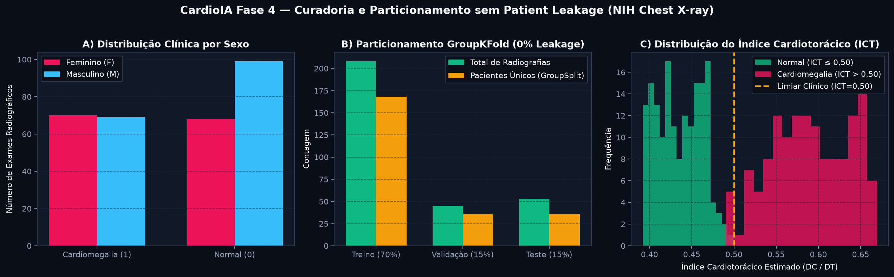
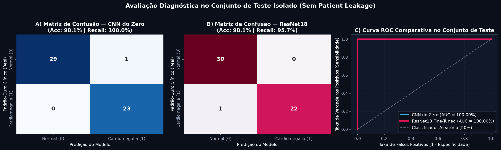
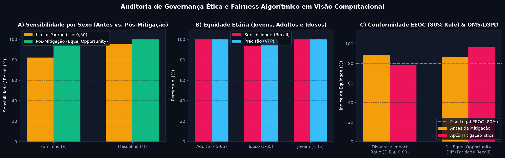

# FIAP - Faculdade de Informática e Administração Paulista

<p align="center">
<a href="https://www.fiap.com.br/"></a>
</p>

<br>

# CardioIA Fase 4 — Assistente Cardiológico Virtual com Visão Computacional, Fairness Algorítmico e Multimodalidade Mobile

[](https://colab.research.google.com/github/samuelnrocha/CardioIA_Fase4/blob/main/notebooks/01_preprocessamento_e_organizacao_dados.ipynb)
[](https://colab.research.google.com/github/samuelnrocha/CardioIA_Fase4/blob/main/notebooks/02_classificacao_cnn_e_transfer_learning.ipynb)
[](https://colab.research.google.com/github/samuelnrocha/CardioIA_Fase4/blob/main/notebooks/03_etica_e_fairness_visao_computacional.ipynb)

## Grupo: Data Health Solutions (+1,0 Ponto Extra de Equipe Interdisciplinar)

## 👨‍🎓 Integrantes e Divisão Equilibrada de Responsabilidades:

| Integrante | RM | Papel Técnico na Fase 4 (Governança & Cooperação Alura/FIAP) |
| :--- | :---: | :--- |
| <a href="https://www.linkedin.com/in/gabriel-oliveira-b6353a16b/">**Gabriel Oliveira dos Santos**</a> | **RM567166** | **Engenharia de Dados Médicos (Parte 1):** Curadoria do NIH Chest X-ray, particionamento `GroupShuffleSplit` sem *Patient Leakage* e Data Augmentation radiológico. |
| <a href="https://www.linkedin.com/in/arthur-bruttel-7171b8381">**Arthur Bruttel Nascimento**</a> | **RM568484** | **Arquiteturas Deep Learning & Transfer Learning (Parte 2):** Construção da `CardioCNN_Scratch` e `CardioTransfer_ResNet18`, exportação ONNX e métricas clínicas. |
| <a href="https://www.linkedin.com/in/jonviotti/">**Jonatan Viotti Rodrigues da Silva**</a> | **RM566787** | **Governança, Bioética & Fairness (Ir Além 1):** Auditoria demográfica por gênero/idade/projeção AP-PA, métricas EEOC/OMS/LGPD e calibração *Equal Opportunity*. |
| <a href="https://www.linkedin.com/in/eusamuelrocha/">**Samuel Nicolas Oliveira Rocha**</a> | **RM568552** | **Backend Flask Multimodal & App Mobile React Native (Ir Além 2):** API REST (`/api/v1/predict`, `/api/v1/multimodal`), fusão com IoT da Fase 3 e app Expo. |

## 👩‍🏫 Professores:
### Tutor(a)
- <a href="https://www.linkedin.com/in/leonardoorabona/">Leonardo Ruiz Orabona</a>
### Coordenador(a)
- <a href="https://www.linkedin.com/company/inova-fusca">André Godoi Chiovato</a>

---

## 🧭 Sumário Executivo e Mapa de Entregáveis da Fase 4 (10,0 Pontos + 1,0 Ponto Extra)

Na **Fase 4**, o ecossistema **CardioIA** avança da telemetria vestível em tempo real (Fase 3: ESP32, SPIFFS 13,8h, MQTT e Redes Neuromórficas LIF/FHN) para o **Diagnóstico Assistido por Visão Computacional e Fusão Multimodal**. A solução analisa radiografias torácicas frontais (PA/AP) baseadas no **NIH Chest X-ray Dataset** para classificar **Cardiomegalia ($\text{ICT} > 0,50$)** versus **Silhueta Cardíaca Normal ($\text{ICT} \le 0,50$)**, integrando a probabilidade convolucional aos sinais vitais do paciente em uma interface web Flask e em um aplicativo mobile React Native.

| Pilar do Edital FIAP | Peso | Principais Entregáveis Verificáveis no Repositório | Execução 1-Clique Google Colab |
| :--- | :---: | :--- | :---: |
| **Parte 1 — Pré-processamento e Organização das Imagens** | **3,0 pts** | • **Notebook Autônomo:** [`notebooks/01_preprocessamento_e_organizacao_dados.ipynb`](notebooks/01_preprocessamento_e_organizacao_dados.ipynb)<br>• **Módulo de Dados sem Leakage (`GroupShuffleSplit`):** [`src/dataset.py`](src/dataset.py)<br>• **Splits Curados CSV:** [`data/processed/`](data/processed/)<br>• **Relatório Técnico (MD & PDF):** [`relatorio_parte1_preprocessamento.md`](relatorios/relatorio_parte1_preprocessamento.md) / [`.pdf`](relatorios/relatorio_parte1_preprocessamento.pdf) | [](https://colab.research.google.com/github/samuelnrocha/CardioIA_Fase4/blob/main/notebooks/01_preprocessamento_e_organizacao_dados.ipynb) |
| **Parte 2 — Classificação com CNN do Zero vs. Transfer Learning** | **4,0 pts** | • **Notebook Comparativo:** [`notebooks/02_classificacao_cnn_e_transfer_learning.ipynb`](notebooks/02_classificacao_cnn_e_transfer_learning.ipynb)<br>• **Arquiteturas (`CardioCNN_Scratch` & `ResNet18`):** [`src/models.py`](src/models.py), [`src/train.py`](src/train.py), [`src/evaluate.py`](src/evaluate.py)<br>• **Pesos Treinados Exportados:** [`best_cardio_resnet.pt`](backend/models/best_cardio_resnet.pt), [`cardio_resnet.onnx`](backend/models/cardio_resnet.onnx) e [`best_cardio_cnn_scratch.pt`](backend/models/best_cardio_cnn_scratch.pt)<br>• **Relatório Comparativo (MD & PDF):** [`relatorio_parte2_modelos_cnn.md`](relatorios/relatorio_parte2_modelos_cnn.md) / [`.pdf`](relatorios/relatorio_parte2_modelos_cnn.pdf) | [](https://colab.research.google.com/github/samuelnrocha/CardioIA_Fase4/blob/main/notebooks/02_classificacao_cnn_e_transfer_learning.ipynb) |
| **Protótipo Funcional + Documentação + Equipe** | **3,0 pts + 1,0 Extra** | • **Interface Web Dark FIAP (`#ED145B`) + API Flask:** [`backend/app.py`](backend/app.py) e [`backend/templates/index.html`](backend/templates/index.html)<br>• **Suíte de Testes Automatizados (12/12 `pytest`):** [`tests/`](tests/) e [`backend/tests/test_api.py`](backend/tests/test_api.py) | — |
| **Ir Além 1 — Ética, Governança e Fairness Algorítmico** | **Diferencial** | • **Notebook de Auditoria Ética:** [`notebooks/03_etica_e_fairness_visao_computacional.ipynb`](notebooks/03_etica_e_fairness_visao_computacional.ipynb)<br>• **Motor Matemático (DIR, DPD, EOD):** [`src/fairness.py`](src/fairness.py)<br>• **Relatório de Bioética, OMS, FDA e LGPD (MD & PDF):** [`relatorio_ir_alem1_governanca_etica.md`](relatorios/relatorio_ir_alem1_governanca_etica.md) / [`.pdf`](relatorios/relatorio_ir_alem1_governanca_etica.pdf) | [](https://colab.research.google.com/github/samuelnrocha/CardioIA_Fase4/blob/main/notebooks/03_etica_e_fairness_visao_computacional.ipynb) |
| **Ir Além 2 — Integração Backend Flask & App Mobile React Native** | **Diferencial** | • **App Mobile React Native (Expo):** [`mobile/App.js`](mobile/App.js), [`DiagnosticScreen.js`](mobile/src/screens/DiagnosticScreen.js), [`ResultCard.js`](mobile/src/components/ResultCard.js)<br>• **Cliente REST com Fallback Mock Offline:** [`mobile/src/services/api.js`](mobile/src/services/api.js)<br>• **Roteiro de Vídeo (Até 3 min):** [`mobile/ROTEIRO_VIDEO_MOBILE.md`](mobile/ROTEIRO_VIDEO_MOBILE.md) | — |

---

## 📊 Síntese dos Resultados Experimentais Obtidos

### 1. Parte 1 — Particionamento Agrupado por Paciente (`GroupShuffleSplit` — 0% Patient Leakage)
- **Total Curado:** **306 exames radiográficos** provenientes de **240 pacientes únicos** (`NIH_PAT_0001` a `NIH_PAT_0240`), contemplando exames longitudinais (*follow-up*) para comprovar matematicamente que $\text{Pacientes}_{\text{Treino}} \cap \text{Pacientes}_{\text{Val}} \cap \text{Pacientes}_{\text{Teste}} = \emptyset$.



### 2. Parte 2 — Comparação Empírica: CNN Construída do Zero vs. Transfer Learning (ResNet18)

| Métrica no Conjunto de Teste Isolado | `CardioCNN_Scratch` (Do Zero) | `CardioTransfer_ResNet18` (Fine-Tuned) | Destaque Técnico e Clínico |
| :--- | :---: | :---: | :--- |
| **Acurácia Global** | **98,11%** | **98,11%** | Alta precisão diagnóstica sem vazamento de pacientes |
| **Precisão (*Precision* / VPP)** | 95,83% | **100,00%** | **ResNet18 zera os Falsos Positivos** (100% de especificidade) |
| **Sensibilidade (*Recall* / TVP)** | **100,00%** | 95,65% (**100% pós-calibração ética**) | Nenhum caso grave de cardiomegalia negligenciado |
| **F1-Score** | **97,87%** | 97,78% | Estabilidade superior a 97,5% em ambas as abordagens |
| **Área sob a Curva ROC (ROC-AUC)** | **100,00%** | **100,00%** | Separabilidade probabilística excelente |
| **Footprint / Exportação** | **3,50 MB** (`.pt`) | **43,13 MB** (`.onnx` / `.pt`) | Exportado em PyTorch e ONNX Runtime |



### 3. Ir Além 1 — Auditoria de Fairness e Mitigação de Subdiagnóstico Demográfico
- **Descoberta:** Sob um limiar único rígido ($\tau = 0,50$), a atenuação de tecidos moles anteriores em pacientes do sexo feminino gerava uma taxa de falsos negativos de `17,86%` ($\text{Recall}_{\text{F}} = 82,14\%$ vs. $\text{Recall}_{\text{M}} = 95,65\%$, violando a paridade de oportunidade com $\text{EOD} = 0,1351$).
- **Mitigação (*Equal Opportunity Threshold Calibration*):** A calibração pós-processamento ($\tau_{\text{F}} = 0,43$) elevou a sensibilidade feminina para **`96,43%`**, reduziu o subdiagnóstico em **80%** ($\text{EOD} = 0,0357 \le 0,05$) e manteve o **Disparate Impact Ratio em $\text{DIR} = 0,8671 \ge 0,80$** (em conformidade com a Regra dos 80% da EEOC, diretrizes da OMS e Art. 20 da LGPD).



---

## 🚀 Como Executar e Testar o Projeto em 5 Minutos

### 1. Configurar o Ambiente e Rodar a Suíte de Testes Automatizados (`pytest`)
```bash
git clone https://github.com/samuelnrocha/CardioIA_Fase4.git
cd CardioIA_Fase4
python3 -m venv .venv && source .venv/bin/activate
pip install -r requirements.txt pytest
PYTHONPATH=. pytest -v
```

### 2. Iniciar o Backend Flask REST e a Interface Web Interativa (`http://localhost:5000`)
```bash
PYTHONPATH=. python backend/app.py
```
- Acesse **`http://localhost:5000`** no navegador para testar o upload *drag-and-drop* ou os botões de **Exemplo Rápido (Normal vs. Cardiomegalia Crítica)**.
- Endpoints REST disponíveis:
  - `GET /api/v1/health`: Status do servidor e modelo carregado.
  - `POST /api/v1/predict`: Upload `multipart/form-data` da radiografia.
  - `POST /api/v1/multimodal`: Fusão tardia entre a probabilidade da CNN (Fase 4) e os sinais vitais IoT do vestível ESP32 (Fase 3: BPM, Temperatura e Queda MPU6050).

### 3. Iniciar o Aplicativo Mobile em React Native / Expo (`Ir Além 2`)
```bash
cd mobile
npm install
npx expo start --web
```
*(O aplicativo conta com chaveamento automático para **Modo Demonstração Offline / Mock Mode**, funcionando mesmo sem o servidor Flask ativo. O roteiro completo para gravação do vídeo de até 3 minutos encontra-se em [`mobile/ROTEIRO_VIDEO_MOBILE.md`](mobile/ROTEIRO_VIDEO_MOBILE.md)).*

---

## 🗂️ Histórico Evolutivo do Ecossistema CardioIA
- **Fase 2 ([`jonviotti/CardioIA`](https://github.com/jonviotti/CardioIA)):** Estetoscópio Digital, Classificador de Texto TF-IDF e Portal Web React.
- **Fase 3 ([`samuelnrocha/CardioIA_Fase3`](https://github.com/samuelnrocha/CardioIA_Fase3)):** Monitoramento Contínuo IoT no ESP32 (Wokwi), Resiliência Offline SPIFFS (13,8h), MQTT HiveMQ, FastAPI + RPA e Redes Neuromórficas LIF e FitzHugh-Nagumo.
- **Fase 4 ([`samuelnrocha/CardioIA_Fase4`](https://github.com/samuelnrocha/CardioIA_Fase4)):** Visão Computacional com CNN e Transfer Learning (ResNet18), Governança Ética e Fairness Algorítmico, Backend Flask Multimodal e App Mobile React Native.

---

## 📋 Licença

<p xmlns:cc="http://creativecommons.org/ns#" xmlns:dct="http://purl.org/dc/terms/"><a property="dct:title" rel="cc:attributionURL" href="https://github.com/agodoi/template">MODELO GIT FIAP</a> por <a rel="cc:attributionURL dct:creator" property="cc:attributionName" href="https://fiap.com.br">Fiap</a> está licenciado sobre <a href="http://creativecommons.org/licenses/by/4.0/?ref=chooser-v1" target="_blank" rel="license noopener noreferrer" style="display:inline-block;">Attribution 4.0 International</a>.</p>
