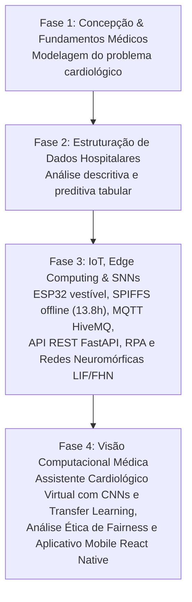

# 00 — Sumário Executivo & Mapa Mental do Projeto
## CardioIA Fase 4: Assistente Cardiológico Virtual com Visão Computacional

---

## 1. Contexto Acadêmico e Institucional

- **Curso:** Pós-Tech / Graduação em Inteligência Artificial para a Saúde
- **Instituição:** FIAP (Faculdade de Informática e Administração Paulista)
- **Grupo de Desenvolvimento:** **Data Health Solutions**
- **Fase Atual:** Fase 4 — Visão Computacional e Assistência Clínica Virtual
- **Requisitos Formais:** Baseado no edital oficial [`fase-4-requirements.txt`](file:///home/samuelrocha/Documents/fiap/fase-4-requirements.txt)

---

## 2. A Evolução do Ecossistema CardioIA

O ecossistema CardioIA foi concebido como uma jornada evolutiva de soluções médicas orientadas a dados. A compreensão desse encadeamento é essencial para que o agente implementador saiba posicionar a solução da Fase 4:



### O Salto da Fase 3 para a Fase 4: Da Telemetria Contínua à Análise Diagnóstica por Imagem
- **Na Fase 3:** O sistema vigiava a paciente no segundo a segundo (batimentos por minuto, temperatura, quedas e movimentos inerciais), atuando como um monitor ambulatorial contínuo de emergência com IA de ultrabaixo consumo (SNN LIF).
- **Na Fase 4:** O assistente ganha "olhos clínicos". Quando o paciente apresenta sinais de alerta ou vai a uma consulta, exames de imagem torácica (como Raio-X de tórax ou traçados digitalizados de ECG) são submetidos a Redes Convolucionais (CNNs) para identificar se o coração está aumentado (**Cardiomegalia**) ou se há consolidações/infiltrados compatíveis com **Congestão Cardiopulmonar**.
- **O Diferencial Multimodal:** Em vez de tratar a Visão Computacional como um silo isolado, a arquitetura permite cruzar o resultado da imagem com o histórico de sinais vitais da Fase 3, oferecendo um assistente verdadeiramente holístico para cardiologistas e clínicos gerais.

---

## 3. Escopo e Objetivos Detalhados da Fase 4

De acordo com o edital oficial da FIAP, o projeto é composto por 4 grandes pilares técnicos mais a exigência de colaboração interdisciplinar:

### 3.1 Parte 1 — Pré-processamento e Organização das Imagens (Peso: 3,0 pts)
1. **Seleção de Dataset Público:** Utilização de dataset representativo de imagens médicas (recomendado pelo edital: **NIH Chest X-rays** do Kaggle com foco em patologias cardiovasculares, ou ECG Image Dataset).
2. **Pipeline de Tratamento:** Redimensionamento padronizado, conversão para escala de cinza / RGB normalizado, eliminação de artefatos visuais e divisão estratificada em Treino, Validação e Teste sem vazamento de pacientes.
3. **Entregáveis:** Notebook Python compatível com Google Colab + Relatório técnico explicativo (1 a 2 páginas).

### 3.2 Parte 2 — Classificação com CNN e Transfer Learning (Peso: 4,0 pts)
1. **Modelo 1 (CNN do Zero):** Arquitetura convolucional customizada (camadas Conv2D, BatchNorm, MaxPooling, Dropout e Dense) projetada para capturar padrões de borda e silhueta cardíaca.
2. **Modelo 2 (Transfer Learning):** Rede neural pré-treinada no ImageNet (ex.: **ResNet50**, **ResNet18** ou **VGG16**) adaptada via *fine-tuning* para a tarefa de classificação binária ou multiclasse.
3. **Avaliação Rigorosa:** Acurácia, Matriz de Confusão, Precisão, Recall, F1-Score e Curva ROC-AUC.
4. **Protótipo de Apresentação:** Interface simples em Flask ou notebook interativo.
5. **Entregáveis:** Notebook Python + Métricas documentadas + Protótipo funcional.

### 3.3 Ir Além 1 — Ética e Governança em Visão Computacional (Item Diferencial)
1. **Auditoria de Vieses:** Identificação de disparidades de desempenho em relação a gênero (Masculino vs. Feminino), faixas etárias ou subgrupos clínicos.
2. **Métricas de Fairness:** Cálculo de métricas matemáticas formais (*Disparate Impact Ratio*, *Demographic Parity*, *Equalized Odds*).
3. **Plano de Mitigação:** Recomendações e políticas de governança segundo diretrizes da OMS, FDA e LGPD.
4. **Entregáveis:** Relatório técnico de até 2 páginas + notebook experimental opcional de fairness.

### 3.4 Ir Além 2 — Aplicativo Mobile em React Native (Item Diferencial)
1. **Interface Mobile:** Aplicativo nativo em React Native / Expo permitindo seleção/upload de imagem médica direto do dispositivo.
2. **Integração com Backend:** Comunicação HTTP REST com API em Python (Flask ou FastAPI) que executa a inferência do modelo treinado.
3. **Exibição Amigável:** Apresentação da categoria detectada, nível de confiança em porcentagem e selo de severidade clínica.
4. **Vídeo Demonstrativo:** Roteiro e material para vídeo de até 3 minutos demonstrando a interação com o app.
5. **Entregáveis:** Repositório com código do app + vídeo gravado/roteirizado.

### 3.5 Bônus de Equipe (+1,0 Ponto Extra)
- Organização documentada no padrão de equipe multidisciplinar (Data Health Solutions) respeitando as diretrizes de cooperação profissional e governança do projeto.

---

## 4. O Mapa Mental da Fase 4

```
                                  CARDIOIA FASE 4
                         Assistente Cardiológico Virtual
                                        │
      ┌──────────────────┬──────────────┴──────────────┬──────────────────┐
      ▼                  ▼                             ▼                  ▼
  [PARTE 1]          [PARTE 2]                    [IR ALÉM 1]        [IR ALÉM 2]
Pré-processamento   Classificação CNN           Ética & Governança  App Mobile
& Dados Médicos     & Transfer Learning         em IA na Saúde      React Native
      │                  │                             │                  │
 ├─ NIH Chest X-ray ├─ CNN do Zero (Custom)       ├─ Análise de Vieses ├─ Upload Câmera/Galeria
 ├─ Filtro Cardiopat.├─ Transfer (ResNet/VGG)     ├─ Demographic Parity├─ Card de Diagnóstico
 ├─ Resize & Normal.├─ ROC, F1, Recall, Matriz    ├─ Equalized Odds    ├─ Backend Flask REST
 └─ Patient Split   └─ Export dos Pesos (.pt/.h5) └─ Relatório Ética   └─ Tema FIAP (#ED145B)
```

---

## 5. Diretrizes para o Agente Implementador

Ao seguir para as próximas seções deste diretório de conhecimento, mantenha em mente:
- **Tudo deve ser reprodutível:** Qualquer colega de equipe, tutor ou avaliador que clonar o repositório deve conseguir rodar os scripts e abrir os notebooks sem erros de path relativo ou dependências ausentes.
- **Utilize o `/colab-mcp`:** Siga as instruções do capítulo 2 para conectar seu ambiente ao Google Colab sempre que for treinar ou validar os modelos.
