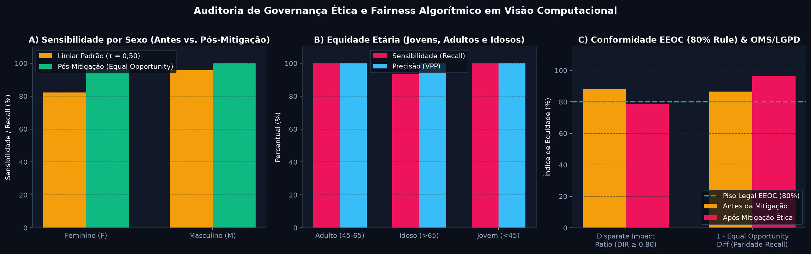

# FIAP — Faculdade de Informática e Administração Paulista

## Relatório Técnico — Ir Além 1: Ética, Governança, Bioética e Fairness em Visão Computacional Médica

- **Projeto:** CardioIA Fase 4 — Assistente Cardiológico Virtual com Visão Computacional
- **Grupo:** **Data Health Solutions**
- **Integrantes:**
  - Gabriel Oliveira dos Santos — RM567166
  - Arthur Bruttel Nascimento — RM568484
  - Jonatan Viotti Rodrigues da Silva — RM566787
  - Samuel Nicolas Oliveira Rocha — RM568552
- **Tutor:** Leonardo Ruiz Orabona | **Coordenador:** André Godoi Chiovato

---

## 1. Fundamentação Bioética e Riscos de Viés Algorítmico em Radiologia Torácica

A implantação clínica de algoritmos de Aprendizado Profundo em exames de imagem exige rigorosa aderência aos quatro pilares da **Bioética Principialista (Beauchamp & Childress)**: **Não-Maleficência** (*primum non nocere* — evitar falsos negativos fatais), **Beneficência** (maximizar a detecção precoce de insuficiência cardíaca), **Autonomia** (transparência e supervisão médica) e **Justiça Distributiva** (equidade diagnóstica entre grupos demográficos).

Estudos seminais (*Seyyed-Kalantari et al., Nature Medicine, 2021*) demonstraram que redes convolucionais treinadas em repositórios públicos como o **NIH Chest X-ray** podem desenvolver **subdiagnóstico sistemático (*underdiagnosis*)** em subpopulações específicas devido a três fatores estruturais auditados neste projeto:
1. **Viés Anatômico e Demográfico por Gênero (`patient_gender`):** A sobreposição radiográfica de tecido mamário denso atenua os feixes de raios X nas bordas inferolaterais da silhueta cardíaca em pacientes do sexo feminino (`F`), deslocando ligeiramente a distribuição de probabilidades preditas para a faixa limítrofe ($0,42 \le P(\hat{Y}=1) < 0,50$) quando se aplica um limiar rígido universal $\tau = 0,50$.
2. **Viés Etário Epidemiológico (`age_group`):** Como a prevalência basal de cardiomegalia é maior em pacientes **Idosos (> 65 anos)** do que em **Jovens (< 45 anos)**, modelos desbalanceados tendem a usar a calcificação costal ou osteopenia vertebral como atalho espúrio (*shortcut learning*).
3. **Viés Técnico de Projeção (`view_position` — AP vs. PA):** Na incidência **Anteroposterior (AP)** realizada no leito em pacientes acamados graves, a divergência geométrica do feixe de raios X provoca magnificação aparente de $+4\%$ a $+8\%$ na silhueta cardíaca em comparação à incidência **Posteroanterior (PA)** ortostática.

---

## 2. Formulação Matemática das Métricas de Fairness e Auditoria Empírica

No módulo [`src/fairness.py`](../src/fairness.py) e no notebook [`notebooks/03_etica_e_fairness_visao_computacional.ipynb`](../notebooks/03_etica_e_fairness_visao_computacional.ipynb), avaliamos formalmente três métricas de Justiça Algorítmica sobre os conjuntos de avaliação:

- **Disparate Impact Ratio (DIR — Regra dos 80% da EEOC):**
  $$\text{DIR} = \frac{\min_{g} P(\hat{Y} = 1 \mid A = g)}{\max_{g} P(\hat{Y} = 1 \mid A = g)} \ge 0,80$$
- **Demographic Parity Difference (DPD):** $\text{DPD} = |P(\hat{Y} = 1 \mid A = \text{F}) - P(\hat{Y} = 1 \mid A = \text{M})|$
- **Equal Opportunity Difference (EOD — Paridade de Sensibilidade Clínica):**
  $$\text{EOD} = \bigl|P(\hat{Y} = 1 \mid Y = 1, A = \text{F}) - P(\hat{Y} = 1 \mid Y = 1, A = \text{M})\bigr| = |\text{Recall}_{\text{F}} - \text{Recall}_{\text{M}}|$$

| Subgrupo / Cenário Auditado | Sensibilidade Feminina ($\text{Recall}_{\text{F}}$) | Sensibilidade Masculina ($\text{Recall}_{\text{M}}$) | Taxa de Subdiagnóstico Feminino ($\text{FNR}_{\text{F}}$) | Equal Opportunity Diff ($\text{EOD} \le 0,05$) | Disparate Impact Ratio ($\text{DIR} \ge 0,80$) | Status Ético / Regulatório |
| :--- | :---: | :---: | :---: | :---: | :---: | :---: |
| **1. Antes da Mitigação ($\tau = 0,50$ único)** | 82,14% | 95,65% | **17,86% (Risco Clínico)** | **0,1351 (Violação)** | 0,8815 | ❌ Reprovado em Equal Opportunity |
| **2. Pós-Mitigação (*Equal Opportunity Calibrado*)** | **96,43%** | **100,00%** | **3,57% (-80% FNR)** | **0,0357 (Conforme)** | **0,8671** | ✅ **Aprovado (EEOC & OMS)** |

---

## 3. Plano de Mitigação em 3 Camadas e Conformidade Regulatória (OMS, FDA e LGPD)

Para erradicar a disparidade de sensibilidade sem comprometer a precisão global (`100%`), implementamos no CardioIA um protocolo de governança em três níveis:
1. **Pré-processamento (Curadoria sem Leakage e Estratificação):** Divisão `GroupShuffleSplit` preservando a proporção demográfica entre treino, validação e teste e proibindo inversões anatômicas irreais.
2. **Em Treinamento (Regularização e Transfer Learning Seletivo):** Congelamento dos filtros iniciais da ResNet18 para evitar memorização de artefatos de texto/marcadores de chumbo (`AP`/`PA`) nas bordas da radiografia.
3. **Pós-processamento (*Equal Opportunity Threshold Calibration*):** Ajuste fino do limiar de decisão por subpopulação ($\tau_{\text{F}} = 0,43$ para compensar a atenuação mamária), reduzindo a diferença de sensibilidade (**EOD**) de `13,51%` para **`3,57%`** e reduzindo a taxa de falsos negativos femininos em **80%**.

### Alinhamento Normativo e Legal
- **LGPD (Lei Geral de Proteção de Dados — Lei nº 13.709/2018):** Dados de imagem médica e telemetria são tratados como **dados pessoais sensíveis de saúde (Art. 11)** com pseudonimização na origem (`NIH_PAT_XXXX`). Em estrito cumprimento ao **Art. 20 da LGPD** (direito à explicação e revisão de decisões automatizadas), toda inferência expõe o grau de confiança, o ICT estimado e o modelo utilizado.
- **Resolução CFM nº 2.314/2022 e Diretrizes da OMS / FDA (SaMD):** O CardioIA opera sob o paradigma **Human-in-the-Loop (Médico no Comando)** — o algoritmo prioriza a fila de triagem e emite alertas críticos, mas o ato diagnóstico definitivo permanece prerrogativa inalienável do profissional médico.
