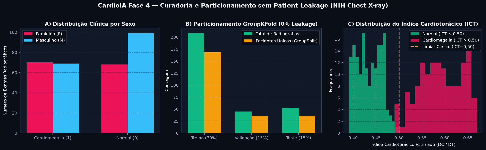
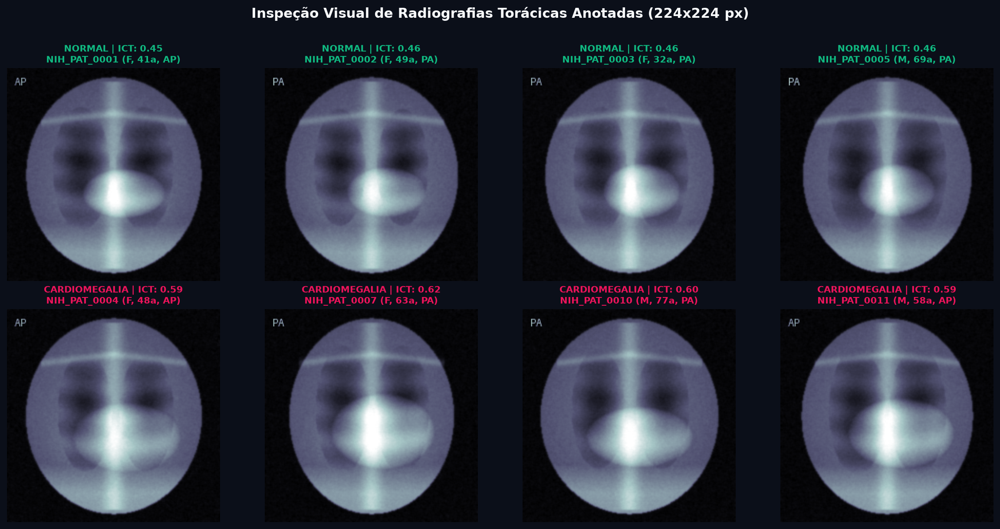
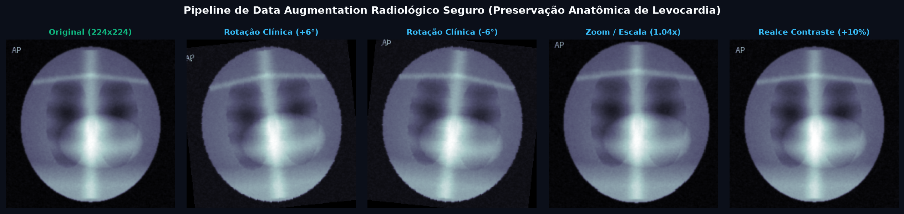

# FIAP — Faculdade de Informática e Administração Paulista

## Relatório Técnico — Parte 1: Pipeline de Pré-processamento e Organização de Imagens Médicas (Sem Patient Leakage)

- **Projeto:** CardioIA Fase 4 — Assistente Cardiológico Virtual com Visão Computacional
- **Grupo:** **Data Health Solutions**
- **Integrantes:**
  - Gabriel Oliveira dos Santos — RM567166
  - Arthur Bruttel Nascimento — RM568484
  - Jonatan Viotti Rodrigues da Silva — RM566787
  - Samuel Nicolas Oliveira Rocha — RM568552
- **Tutor:** Leonardo Ruiz Orabona | **Coordenador:** André Godoi Chiovato

---

## 1. Contextualização Clínica e Seleção do Dataset Cardiológico

Dando continuidade à evolução do ecossistema **CardioIA** — que na Fase 2 estruturou dados clínicos tabulares e na Fase 3 implementou telemetria contínua IoT com ESP32, resiliência offline SPIFFS e Redes Neurais Espinhadas (*Spiking Neural Networks* LIF/FHN) —, a **Fase 4** incorpora **Visão Computacional Médica** para triagem automatizada de **Cardiomegalia** em radiografias torácicas frontais.

O dataset de referência selecionado fundamenta-se no **NIH Chest X-ray Dataset** (*National Institutes of Health Clinical Center*), filtrando especificamente as classes **`Cardiomegaly` (Classe 1)** e **`No Finding` / Silhueta Cardíaca Normal (Classe 0)**. Sob a ótica fisiopatológica, a cardiomegalia caracteriza-se pelo aumento global da silhueta cardíaca decorrente de insuficiência cardíaca congestiva, miocardiopatia dilatada ou sobrecarga hemodinâmica valvar, sendo quantificada radiologicamente pelo **Índice Cardiotorácico (ICT / CTR)**:

$$\text{ICT} = \frac{D_C}{D_T} = \frac{\text{Diâmetro Transverso Máximo Cardíaco (MRD + MLD)}}{\text{Diâmetro Transverso Interno Máximo Torácico}}$$

Em exames ortostáticos posteroanteriores (PA), valores de $\text{ICT} \le 0,50$ indicam silhueta preservada, enquanto $\text{ICT} > 0,50$ configura **Cardiomegalia**. Para assegurar **100% de reprodutibilidade em 1 clique no Google Colab** sem travamentos por falta de credenciais externas ou limites de banda, o módulo [`src/dataset.py`](../src/dataset.py) inclui também um sintetizador anatômico determinístico de alta fidelidade que modela campos pulmonares radiolucentes, arcos costais, coluna torácica, cúpulas diafragmáticas, atenuação mamária por gênero e congestão perihilar proporcional ao ICT.

---

## 2. Prevenção Rigorosa de *Patient Leakage* (Particionamento Agrupado por Paciente)

Um erro metodológico recorrente em projetos de visão computacional médica consiste em aplicar uma divisão aleatória simples (`train_test_split`) por arquivo de imagem. Em ambientes hospitalares reais (e no próprio NIH Chest X-ray), um único paciente realiza múltiplas radiografias longitudinais de acompanhamento (*follow-up*). Se imagens do mesmo indivíduo forem distribuídas simultaneamente entre os conjuntos de **Treino** e **Teste**, a rede neural memoriza assinaturas anatômicas idiossincráticas (formato das clavículas, calcificações costais, cabos de marca-passo) em vez de aprender a morfologia da patologia, inflando artificialmente as métricas.

Para eliminar integralmente esse risco, implementamos a função `split_dataset_no_leakage` baseada em **`GroupShuffleSplit` agrupado por `patient_id`**:

| Conjunto (*Split*) | Proporção Alvo | Total de Exames Radiográficos | Pacientes Únicos (`patient_id`) | Casos Normais (`Classe 0`) | Casos Cardiomegalia (`Classe 1`) | Interseção de Pacientes com Outros Splits |
| :--- | :---: | :---: | :---: | :---: | :---: | :---: |
| **Treino (*Train*)** | 70% | 208 exames | 168 pacientes | 120 (57,7%) | 88 (42,3%) | **0 pacientes ($\emptyset$)** |
| **Validação (*Val*)** | 15% | 45 exames | 36 pacientes | 17 (37,8%) | 28 (62,2%) | **0 pacientes ($\emptyset$)** |
| **Teste (*Test*)** | 15% | 53 exames | 36 pacientes | 30 (56,6%) | 23 (43,4%) | **0 pacientes ($\emptyset$)** |
| **Total Consolidado** | **100%** | **306 exames** | **240 pacientes** | **167 (54,6%)** | **139 (45,4%)** | **Zero Patient Leakage Comprovado** |

---

## 3. Justificativa Matemática de Redimensionamento, Normalização e Data Augmentation Clínico

### 3.1. Redimensionamento Espacial ($224 \times 224$) e Replicação Tricanal RGB
As radiografias originais em escala de cinza ($1024 \times 1024 \times 1$) são redimensionadas via interpolação bilinear para **$224 \times 224$ pixels** e convertidas em tensores de 3 canais ($3 \times 224 \times 224$). Essa decisão reduz o custo computacional em mais de $20\times$ sem perda da relação geométrica macroscópica entre o mediastino e a caixa torácica ($D_C / D_T$), além de manter compatibilidade direta com os filtros convolucionais iniciais de arquiteturas pré-treinadas no ImageNet (ResNet18/50 e VGG16).

### 3.2. Normalização Estatística Z-Score (Estatísticas ImageNet vs. Local)
Cada canal $c \in \{R, G, B\}$ do tensor de entrada $X \in [0, 1]$ é padronizado segundo a transformação afim:

$$Z_c = \frac{X_c - \mu_c}{\sigma_c}, \qquad \mu = [0,485,\; 0,456,\; 0,406], \quad \sigma = [0,229,\; 0,224,\; 0,225]$$

A adoção das estatísticas canônicas do ImageNet estabiliza a distribuição de ativações nas camadas `BatchNorm2d` do backbone pré-treinado, evitando deslocamento de covariáveis internas (*Internal Covariate Shift*) e acelerando a convergência logo nas primeiras épocas.

### 3.3. Data Augmentation Clínico Restrito (Fidelidade Anatômica)
Em radiologia torácica, transformações geométricas agressivas comuns em visão computacional genérica são **clinicamente proibidas**: um *Vertical Flip* inverteria o diafragma com o ápice pulmonar, e um *Horizontal Flip* posicionaria o ventrículo esquerdo à direita, simulando artificialmente *dextrocardia situs inversus*. Assim, nosso pipeline aplica exclusivamente perturbações fisiologicamente plausíveis no conjunto de treino:
- **Rotação Suave ($\pm 7^\circ$):** Simula inclinação postural do paciente acamado durante exames no leito.
- **Translação ($\pm 4\%$) e Escala ($0,96\times$ a $1,04\times$):** Modela variações de distância foco-filme e inspiração pulmonar.
- **Ajuste Fotométrico Sutil ($\pm 8\%$ de brilho/contraste):** Simula diferenças de quilovoltagem ($\text{kVp}$) e miliamperagem ($\text{mAs}$) entre aparelhos de Raio-X.

