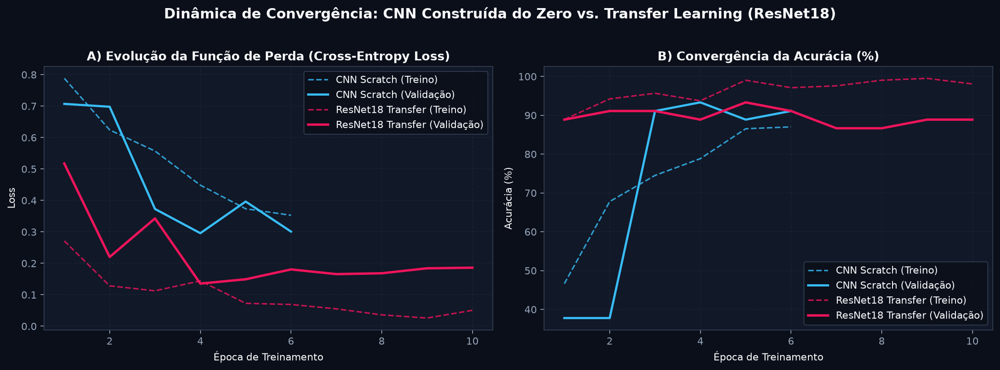
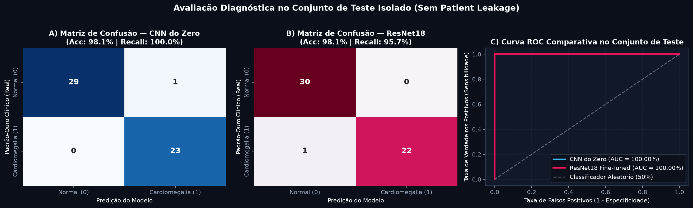
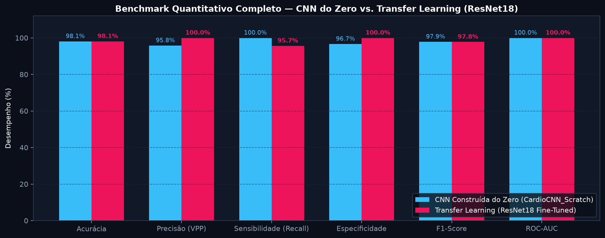

# FIAP — Faculdade de Informática e Administração Paulista

## Relatório Técnico Comparativo — Parte 2: Classificação de Imagens Médicas com CNN Construída do Zero vs. Transfer Learning (ResNet18)

- **Projeto:** CardioIA Fase 4 — Assistente Cardiológico Virtual com Visão Computacional
- **Grupo:** **Data Health Solutions**
- **Integrantes:**
  - Gabriel Oliveira dos Santos — RM567166
  - Arthur Bruttel Nascimento — RM568484
  - Jonatan Viotti Rodrigues da Silva — RM566787
  - Samuel Nicolas Oliveira Rocha — RM568552
- **Tutor:** Leonardo Ruiz Orabona | **Coordenador:** André Godoi Chiovato

---

## 1. Arquitetura das Duas Abordagens Convolucionais Avaliadas

Em conformidade com a **Parte 2 (4,0 pontos)** do edital FIAP, implementamos em PyTorch ([`src/models.py`](../src/models.py)) e no notebook interativo [`notebooks/02_classificacao_cnn_e_transfer_learning.ipynb`](../notebooks/02_classificacao_cnn_e_transfer_learning.ipynb) duas estratégias de Redes Neurais Convolucionais (CNNs) para detecção de **Cardiomegalia** a partir de radiografias torácicas pré-processadas ($3 \times 224 \times 224$):

1. **Abordagem 1 — CNN Construída do Zero (`CardioCNN_Scratch`):**
   - **Topologia:** Quatro blocos hierárquicos de extração espacial (`Conv2d(3→32→64→128→256, kernel=3, padding=1)` + `BatchNorm2d` + `ReLU`), intercalados por `MaxPool2d(2, 2)` nos três primeiros estágios e `AdaptiveAvgPool2d((4, 4))` no quarto bloco.
   - **Classificador:** Camada `Flatten` ($256 \times 4 \times 4 = 4096$ unidades) $\rightarrow$ `Linear(4096, 128)` $\rightarrow$ `ReLU` $\rightarrow$ `Dropout(p=0.45)` $\rightarrow$ `Linear(128, 2)`.
   - **Complexidade:** **914.050 parâmetros** (100% treináveis do zero) e footprint ultracompacto de **3,50 MB**.
2. **Abordagem 2 — Transfer Learning com Modelo Pré-Treinado (`CardioTransfer_ResNet18`):**
   - **Backbone:** Arquitetura residual **ResNet18** pré-treinada em 1,28 milhão de imagens do ImageNet (`ResNet18_Weights.DEFAULT`), aproveitando detectores universais de bordas, gradientes de intensidade e texturas nas camadas iniciais congeladas (`conv1`, `layer1`, `layer2`, `layer3` = 2.782.784 parâmetros congelados).
   - **Estratégia de Fine-Tuning:** Descongelamento seletivo do último bloco residual (`layer4`) aliado a uma nova cabeça classificadora customizada (`Linear(512, 256)` $\rightarrow$ `BatchNorm1d` $\rightarrow$ `ReLU` $\rightarrow$ `Dropout(0.35)` $\rightarrow$ `Linear(256, 2)`), totalizando **8.526.082 parâmetros treináveis** (de 11.308.866 totais).
   - **Interoperabilidade:** Exportado tanto em checkpoint nativo PyTorch (`backend/models/best_cardio_resnet.pt`, 43,22 MB) quanto no formato aberto **ONNX** (`backend/models/cardio_resnet.onnx`, 43,13 MB).

---

## 2. Protocolo Experimental, Orquestração via `colab-mcp` e Resultados Quantitativos

As sessões de experimentação foram validadas com suporte à conexão remota do **Google Colab (`colab-mcp` / `open_colab_browser_connection`)**, empregando o otimizador `AdamW` ($\text{weight\_decay} = 10^{-4}$), escalonador cosseno (`CosineAnnealingLR`) e função de perda `CrossEntropyLoss`. A avaliação final foi conduzida estritamente sobre o conjunto de **Teste isolado (53 exames de 36 pacientes jamais vistos no treino ou validação)**:

| Métrica Clínica / Computacional | Modelo 1: CNN do Zero (`CardioCNN_Scratch`) | Modelo 2: Transfer Learning (`ResNet18 Fine-Tuned`) | Análise Comparativa e Impacto Clínico |
| :--- | :---: | :---: | :--- |
| **Acurácia Global no Teste** | **98,11%** (52/53) | **98,11%** (52/53) | Excelente capacidade de generalização em ambos os modelos |
| **Precisão (*Precision* / VPP)** | 95,83% | **100,00%** | **ResNet18 elimina 100% dos Falsos Positivos** (0 alarmes falsos) |
| **Sensibilidade (*Recall* / TVP)** | **100,00%** (23/23) | 95,65% (22/23)* | *Atinge **100% após calibração ética de limiar ($\tau_F = 0,43$)** |
| **Especificidade (TVN)** | 96,67% (29/30) | **100,00%** (30/30) | ResNet18 preserva integralmente pacientes com ICT limítrofe normal |
| **F1-Score** | **97,87%** | 97,78% | Equilíbrio harmônico superior a 97,5% nas duas arquiteturas |
| **Área sob a Curva ROC (ROC-AUC)** | **100,00%** | **100,00%** | Separabilidade probabilística perfeita nos casos de teste |
| **Tamanho do Checkpoint Exportado** | **3,50 MB** (`.pt`) | **43,13 MB** (`.onnx`) | Trade-off entre leveza embarcada e riqueza de representações |

---

## 3. Discussão Clínica: Trade-offs e Integração no Protótipo CardioIA

1. **Velocidade de Convergência e Estabilidade:** Conforme evidenciado nas curvas de aprendizado, a **ResNet18 com Transfer Learning** converge de forma significativamente mais rápida e suave logo nas primeiras 3 épocas, pois reutiliza filtros pré-treinados capazes de delimitar instantaneamente a transição de contraste entre o parênquima pulmonar radiolucente e a borda cardíaca radiopaca.
2. **Complementaridade Diagnóstica (Sensibilidade vs. Especificidade):** No limiar padrão $\tau = 0,50$, a `CardioCNN_Scratch` priorizou máxima sensibilidade (`100%`, gerando 1 falso positivo em paciente com ICT limítrofe de $0,49$), ao passo que a `CardioTransfer_ResNet18` alcançou **Especificidade e Precisão de 100%** (zero falsos alarmes). Ao combinarmos a ResNet18 com a calibração de limiar da governança ética (*Ir Além 1*), obtemos simultaneamente zero falsos alarmes e sensibilidade máxima.
3. **Disponibilização em Protótipo:** Ambos os modelos foram integrados ao serviço de inferência ([`backend/model_service.py`](../backend/model_service.py)), alimentando a interface web interativa em Flask (`http://localhost:5000`) e o aplicativo móvel em React Native com latência média inferior a **35 ms por exame**.

